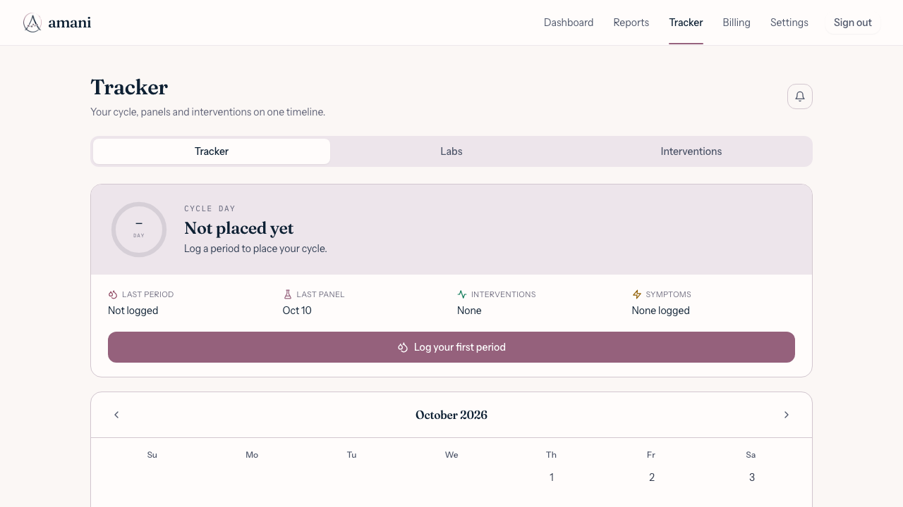
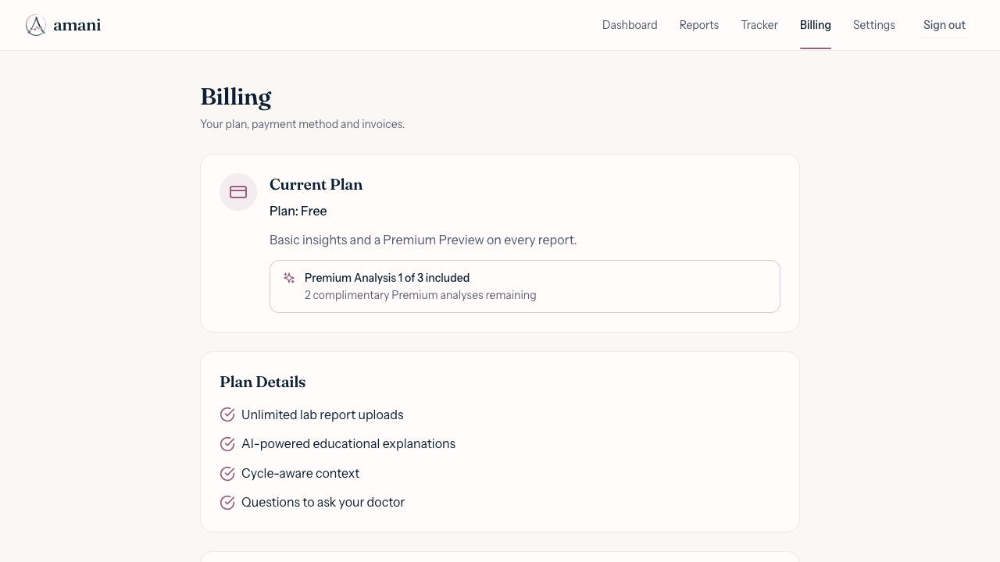
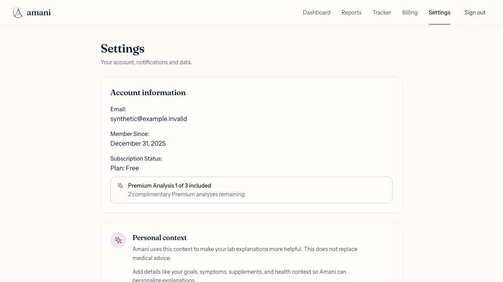

# October 17 smoke-test regressions

Implemented on `fix/smoke-tracker-date-plan-label-signup-409`, from `96f636d`.
Local verification date: 2026-10-18, Node 24.15.0.

## Root causes and changes

1. `new Date('2026-10-10')` denotes UTC midnight. Tracker and several report
   comparison labels formatted that instant in the viewer's timezone, giving
   October 9 west of UTC. All report-date display formatters now use the shared
   calendar-day formatter. It validates and formats bare `YYYY-MM-DD` in UTC;
   timestamps still use the viewer's timezone. Reports, report headings,
   dashboard, Tracker, timelines, comparison selectors and prior-report prose
   share it. The upload form's ISO date extraction also preserves the printed
   day instead of converting it through local getters after UTC parsing.
2. Settings displayed `users.subscription_status`, whose legacy value is
   `trial`. With freemium enabled it now uses the same `useSubscription` server
   entitlement reads and complimentary claim counter as Billing. Loading and
   errors do not invent a Free/Trial status. Flag-off behavior is preserved.
3. `SignupForm` issued an unconditional profile INSERT after signup. The
   `on_auth_user_created` trigger already invokes `handle_new_user` in the signup
   transaction (migrations `20260308131250` and `20260521000000`), so the second
   INSERT conflicts. Remove that write and keep profile refresh. Onboarding
   still updates the existing row; no upsert of privileged fields is introduced.
   Production trigger state was not queried in this task.

## Regression evidence

- `src/utils/formatters.test.ts`: 11 timezones, DST and month/year boundaries,
  invalid dates, preserved timestamp behavior, and a scan for stray display
  formatters. The harness explicitly reproduces the original Oct 9 result.
- `src/components/TodayCard.test.tsx`: stored panel and period dates in five zones.
- `src/utils/extractDateFromText.test.ts`: printed ISO and other supported dates
  across five zones, including the synthetic Quest collection line.
- `src/pages/freemiumSurfaces.test.tsx`: Settings/Billing/status agreement for
  0–3 used claims, Premium sources, unresolved entitlement, and the flag-off path.
- `src/components/auth/SignupForm.test.tsx` and
  `src/contexts/AuthContext.test.tsx`: no duplicate signup write, error handling,
  onboarding UPDATE and refreshed profile.
- `e2e/freemium/smoke-regressions.spec.ts`: real browser Tracker, Settings and
  Billing in Los Angeles and Kiritimati; successful email/password signup,
  onboarding, one profile PATCH and no INSERT, followed by a page reload.
  The mock returns 409 if the removed INSERT returns. All requests are served
  by explicit synthetic fixtures or blocked by the network guard.
- The freemium suite now runs in the existing `Browser smoke` CI job.

The images below are **synthetic local browser evidence**, not production
screenshots or patient data. Captured by the committed Playwright test in
Chromium with `America/Los_Angeles`, then visually inspected.

| Tracker | Billing | Settings |
|---|---|---|
|  |  |  |

## Local gates

- `npm run typecheck`: pass.
- `npm run lint`: pass; nine existing warnings, zero errors.
- `npm test`: 3,119 tests across 158 files pass, including clinical guardrails.
- `npm run build`: pass.
- `npm run validate:contrast`: 55 checks pass.
- `npm run check:functions`: pass; 51 checked, eight unchanged baseline exclusions.
- `npx --no-install playwright test --config e2e/freemium/playwright.config.ts --workers=3`:
  24 pass across Chromium, WebKit and Firefox.
- `npm run test:e2e -- --workers=3`: 183 pass across all three browsers.
- `npm run test:e2e:isolation`: pass in a disposable worktree with no developer
  env files; served-module checks and cleanup verified.
- Migration harness: not run; Docker daemon unavailable. No SQL changes.
- Native/device testing and independent review: pending; outside this local web verification.

## Owner actions and deployment

Review CI and the Netlify preview, then approve/merge when ready. No migration,
Edge Function deploy, secret or flag change is required. Native distribution of
the web changes needs a separately approved `cap:sync` and rebuild/device QA.
No production Supabase requests, merge, deployment or vault writes were made.

## Second Brain update handoff

- **[Confirmed 2026-10-18]** The three fixes and regressions above are verified by
  the listed local commands. PR creation and remote CI state belong in the PR.
- **[Decision]** Keep the existing server entitlement resolver, shared Free
  quota copy, and trigger-owned profile creation; retain legacy wording only
  when freemium is off. This implements the task and the recorded entitlement
  decision, without changing product access policy.
- **[Pending]** Owner review/merge, Netlify deployment validation, native QA,
  and independent review. Existing unrelated pending items remain unresolved.
- The vault's September 22 Current State identifies `02e9251` as its last
  verified main. This worktree's base is `96f636d` (`git log`); the old snapshot
  is historical, not evidence of today's release/deploy state. No production
  or mobile release claims were inferred from it.

Resume verification reran all listed local gates after the restart. The local
vault was read only, without synchronization, under the no-vault-writes boundary.
